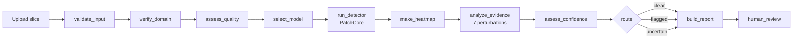

<div align="center">

# 🧠 BrainSentinel

### Evidence-grounded, agentic anomaly review for brain MRI

Unsupervised anomaly detection trained on **normal scans only**, wrapped in an 11-step **LangGraph** review workflow that explains every flag with checkable evidence and knows when to say *"inconclusive"*.


*Built for the Agentic AI Hackathon 2026 (Ulster University, UK)*

</div>

> ⚠️ **Not a medical device.** BrainSentinel is a research prototype for qualified human review. It is trained on one public dataset, has not been clinically validated, and must not be used for diagnosis or treatment decisions.

---

## Table of contents
1. [Why BrainSentinel](#why-brainsentinel)
2. [Highlights](#highlights)
3. [How it works](#how-it-works)
4. [Dataset](#dataset)
5. [Models compared](#models-compared)
6. [Results](#results)
7. [Evaluation protocol](#evaluation-protocol)
8. [Tech stack](#tech-stack)
9. [Quick start](#quick-start)
10. [API](#api)
11. [Project structure](#project-structure)
12. [Limitations](#limitations)
13. [References](#references)
14. [Author](#author)

---

## Why BrainSentinel
Pixel-level tumour annotations are expensive and cover only known pathologies, while most routine scans are normal. Many AI tools also return a bare score with no evidence, no uncertainty and no way to abstain.

BrainSentinel learns what **normal** anatomy looks like, localises regions that deviate from it, and then puts an **agentic review layer** on top: quality and domain checks, stability tests, confidence routing and a human sign-off.

## Highlights
- **Normal-only training.** No pixel labels or anomalous examples needed (7,500 normal training slices).
- **Multi-model comparison.** Convolutional autoencoder vs **PaDiM** vs **PatchCore**, evaluated under one protocol.
- **Agentic evidence layer.** 11-node LangGraph workflow with 7 perturbation tests; every statement carries a resolvable reference.
- **Knows when not to answer.** Unsupported or non-brain input is rejected; verdicts can be `ANOMALY_DETECTED`, `NO_ANOMALY_DETECTED` or `INCONCLUSIVE` with a reliability level.
- **Honest evaluation.** Thresholds frozen on validation, test split used once per model, failures reported.
- **Light and fast.** PatchCore runs in about 4.5 ms per slice with 0.13 GB peak inference VRAM on an RTX 4060 laptop GPU.
- **Full stack.** FastAPI + SQLite backend, React/Vite review UI, audit trail of every review.

## How it works



| Stage | What it does |
|---|---|
| **Input validation** | Accepts only opaque RGBA slices in the BMAD palette encoding the model was trained on; others get a `422 unsupported_encoding` error. |
| **Domain and quality checks** | Verifies the image matches the training domain and flags quality problems. |
| **Detector** | PatchCore compares ResNet18 patch features with a memory bank of normal patches; the maximum of the anomaly map is the image score. |
| **Evidence analysis** | Seven perturbation tests check that the flag is stable; results become grounded statements. |
| **Confidence and routing** | Cases are routed `clear`, `flagged` or `uncertain`; scores near the threshold lower reliability. |
| **Report and human review** | Verdict, heatmap, evidence, limitations and an accept/reject decision stored in SQLite. |

An optional LLM narrator exists but is **off by default**; detector and deterministic checks make the decisions.

## Dataset
**BMAD Brain MRI**, derived from **BraTS 2021 (FLAIR)**, 240×240 PNG slices.

| Split | Slices | Content |
|---|---|---|
| Train | 7,500 | normal only |
| Validation | 83 | normal + abnormal (used for threshold and model selection) |
| Test | 3,715 | normal + abnormal (used once per model) |

- BMAD benchmark: <https://github.com/DorisBao/BMAD>
- BraTS 2021 challenge: <https://www.synapse.org/Synapse:syn25829067>
- BraTS 2021 data paper: <https://arxiv.org/abs/2107.02314>

Slices are palette-encoded RGBA PNGs; preprocessing recovers the palette index from a train-derived palette, subtracts the corner background, scales to [0, 1] and replicates to three channels. Please obtain the data from the sources above and follow their licences; the dataset is not redistributed here.

## Models compared

| Model | Idea | Notes |
|---|---|---|
| **Convolutional autoencoder** | Reconstruct normal slices; error is the anomaly signal | Baseline. Fails on this data (below chance). |
| **PaDiM** | Gaussian per-position model of patch features, Mahalanobis distance | Paper-default setup, not tuned. |
| **PatchCore** | ResNet18 layer2+3 features, 3×3 aggregation, greedy k-center coreset (1%), 1-NN distance | Best model and the default detector. |

An optional **PCA reducer** (fitted on training embeddings only) is evaluated under a rule fixed in advance: keep only if every quality drop (image AUROC, pixel AUROC, AUPRO) is ≤ 0.01 **and** latency or model size improves ≥ 20%.

## Results

All numbers come from the project's own runs. **Test results are a single seed.**

### Test split (3,715 slices)

| Model | Image AUROC | Image AUPR | Pixel AUROC | AUPRO | Dice | Latency (ms) | Peak VRAM (GB) |
|---|---|---|---|---|---|---|---|
| **PatchCore** | **0.909** | **0.977** | **0.979** | **0.847** | **0.501** | 4.5 | 0.13 |
| PaDiM | 0.754 | 0.920 | 0.960 | 0.782 | 0.419 | 1.1 | 0.05 |
| Autoencoder | 0.254 | 0.721 | 0.854 | 0.592 | 0.207 | 0.7 | 0.01 |

### Validation split (83 slices)

| Model | Image AUROC | Pixel AUROC | AUPRO | Dice | Image FPR |
|---|---|---|---|---|---|
| PatchCore | 0.930 | 0.986 | 0.898 | 0.520 | 0.077 |
| PaDiM | 0.874 | 0.971 | 0.816 | 0.448 | 0.154 |
| Autoencoder | 0.352 | 0.832 | 0.502 | 0.193 | 1.000 |

On the test split the image-level false-positive rate at the validation-frozen threshold is **12.2%** for PatchCore and 22.3% for PaDiM.

### PCA experiments (validation only)

| Model | Variant | Dims | Image AUROC | Pixel AUROC | AUPRO | Size (MB) | Decision |
|---|---|---|---|---|---|---|---|
| PatchCore | no PCA | 384 | 0.930 | 0.986 | 0.898 | 37.0 | baseline |
| PatchCore | PCA 99% | 250 | 0.920 | 0.987 | 0.890 | 28.2 | **keep** |
| PatchCore | PCA 95% | 116 | 0.917 | 0.986 | 0.879 | 18.8 | reject |
| PaDiM | no PCA | 384 | 0.912 | 0.976 | 0.842 | 518.2 | baseline |
| PaDiM | PCA 99% | 278 | 0.904 | 0.974 | 0.835 | 277.4 | keep |
| PaDiM | PCA 95% | 158 | 0.902 | 0.971 | 0.817 | 97.1 | reject |
| PaDiM | random 100 dims (paper default) | 100 | 0.874 | 0.971 | 0.816 | 45.3 | reject |

### Engineering
- PatchCore training: about 6–7 minutes, 3.5 GB peak training VRAM, 37 MB checkpoint.
- Inference: about 4.5 ms per slice (≈220 slices/s), 0.13 GB peak VRAM.
- Tests: 219 backend and 8 frontend tests passing at last run.

## Evaluation protocol
- Thresholds are fitted on the **validation** split and frozen; the threshold tool refuses non-validation data.
- The test split is evaluated **once per model** and logged.
- Model selection used predeclared rules (VRAM ≤ 6 GB, latency ≤ 1000 ms, within 0.02 AUPRO, mean rank).
- Metrics: image AUROC/AUPR, pixel AUROC/AUPR, **AUPRO** (FPR ≤ 0.3), Dice, IoU, latency, VRAM, checkpoint size.
- Supporting analyses in the code: patient-level bootstrap confidence intervals, brain-ROI vs full-frame metrics, patient-disjoint run, slice-stratified AUROC.

## Tech stack

| Layer | Technology |
|---|---|
| Models | PyTorch, torchvision (ResNet18), NumPy, scikit-learn |
| Agent workflow | LangGraph |
| Backend | FastAPI, Uvicorn, SQLite |
| Frontend | React, Vite |
| Testing | pytest, Vitest |
| Packaging | Docker files provided (not yet verified end to end) |

## Quick start

```bash
git clone https://github.com/AryanDhanuka10/Brain_Sentinel.git
cd Brain_Sentinel
python -m venv .venv && source .venv/bin/activate
pip install -r requirements.txt
```

Place the BMAD Brain data as described in `data/README.md`.

**Train, evaluate, compare**
```bash
python scripts/train.py --config configs/patchcore.yaml        # also: padim.yaml, autoencoder.yaml
python scripts/evaluate.py --run artifacts/models/patchcore_s0 --split valid
python scripts/evaluate.py --run artifacts/models/patchcore_s0 --split test   # once per model
python scripts/make_comparison.py --runs artifacts/models/*_s0
python scripts/pca_experiments.py --model patchcore
```

**Run the app**
```bash
# backend
uvicorn brainsentinel.api.main:app --port 8000
# frontend (new terminal)
cd frontend && npm install && npm run dev
```
Open <http://localhost:5173>, upload a 240×240 BMAD-encoded slice and review the report.

**Run tests**
```bash
pytest -q
cd frontend && npm test
```

## API
The FastAPI service provides endpoints to upload a slice, run the agent workflow, fetch a stored report and record the human review decision. Interactive docs are served at <http://localhost:8000/docs> when the backend is running.

## Project structure
```
Brain_Sentinel/
├── configs/            # autoencoder / padim / patchcore settings
├── scripts/            # train, evaluate, select_model, make_comparison, pca_experiments, predict_one
├── src/brainsentinel/
│   ├── models/         # autoencoder, PaDiM, PatchCore, PCA reducer
│   ├── evaluation/     # metrics, thresholding, runner
│   ├── inference/      # checks, evidence, rendering, prediction
│   ├── agents/         # LangGraph workflow and report builder
│   └── api/            # FastAPI app and SQLite storage
├── frontend/           # React + Vite review UI
├── docs/               # results, model card, deployment notes
├── tests/
└── artifacts/ results/ # trained runs and logs (generated)
```

## Limitations
- Single seed for test results; the 83-image validation set is small.
- **Localisation inside the brain is much weaker than full-frame** (AUPRO 0.583 restricted to the brain ROI vs 0.847 full-frame), because background is easy to score.
- The autoencoder baseline fails; PaDiM was run at its paper default, not tuned.
- A normal slice can be flagged (about 12% false-positive rate at the frozen threshold), which is why every case goes to human review.
- Trained and tested on one public dataset; no external or clinical validation.
- Accepts only BMAD palette-encoded RGBA PNGs.

## References
1. Roth et al., *Towards Total Recall in Industrial Anomaly Detection* (PatchCore), CVPR 2022.
2. Defard et al., *PaDiM: a Patch Distribution Modeling Framework for Anomaly Detection and Localization*, ICPR 2021.
3. Bao et al., *BMAD: Benchmarks for Medical Anomaly Detection*, CVPR Workshops 2024.
4. Baid et al., *The RSNA-ASNR-MICCAI BraTS 2021 Benchmark on Brain Tumor Segmentation and Radiogenomic Classification*, arXiv:2107.02314.
5. LangGraph documentation: <https://langchain-ai.github.io/langgraph/>

## Author
**Aryan Dhanuka**, B.Tech CSE (AI), Bennett University.
GitHub: [AryanDhanuka10](https://github.com/AryanDhanuka10) · Email: aryandhanuka.dev@gmail.com

## License
Add a licence of your choice (for example MIT) as `LICENSE`. Dataset licences remain with their original providers.