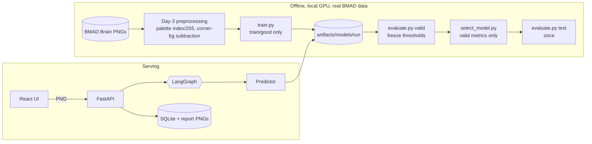

# Project architecture

BrainSentinel = (1) a normal-only anomaly-detection benchmark on BMAD Brain, (2) an evidence-grounded LangGraph review workflow around the selected model, (3) a FastAPI service and React UI. **Research prototype; not a diagnostic device.**

Agent graph: `validate_input → verify_domain → assess_quality → select_model → run_detector → make_heatmap → analyze_evidence → assess_confidence → route_{clear|flagged|uncertain} → build_report → human_review`. Any failing stage jumps to `build_report` with a terminal status.

| Layer | Path | Notes |
|---|---|---|
| Data | `src/brainsentinel/data/` | Day 1-3 (palette, index, dataset, preprocessing) |
| Models | `src/brainsentinel/models/` | autoencoder, PaDiM, PatchCore, reducers (PCA) in plain PyTorch |
| Evaluation | `src/brainsentinel/evaluation/` | metrics, thresholds, runner (test guard) |
| Orchestration | `src/brainsentinel/pipeline.py` | train / evaluate / select; used by `scripts/` |
| Inference | `src/brainsentinel/inference/` | checks, evidence, render, Predictor |
| Agents | `src/brainsentinel/agents/` | state, nodes, graph, report, narrate |
| API | `src/brainsentinel/api/` | FastAPI + SQLite |
| UI | `frontend/` | React + Vite |

Run directory contract (`artifacts/models/<run_id>/`): `model.pt`, `model.json`, `config.json` (resolved normalisation, seed, runtime, VRAM), `palette.json`, `threshold.json` (validation-derived), `pred_<split>/` (maps/masks/meta), `metrics_<split>.json`, `evaluations.jsonl` (audit trail).
